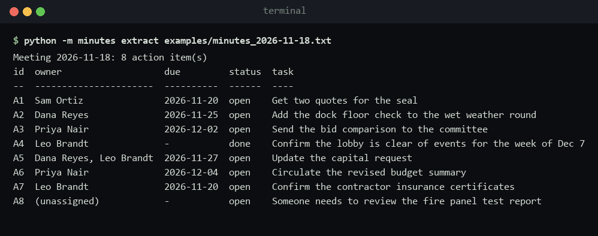

<p align="center"></p>

# meeting-minutes-action-tracker

Action items die in meeting minutes. Someone writes "Sam to get quotes by Friday" in a paragraph, and nobody sees it again. This repo reads plain text minutes, pulls out every action item with its owner and a real due date, and tells you what is overdue or has no owner.



## What it is for

Project coordinators and facility managers who take minutes in a text file or paste them from a notes app. The tool finds action items written the way people actually write them, resolves words such as "Friday" or "end of week" against the meeting date, and gives a table, CSV or JSON. It then answers the follow up questions: what is overdue, what does each person own, which items have no owner or no date.

## Install

```
git clone https://github.com/yassine2med/meeting-minutes-action-tracker
cd meeting-minutes-action-tracker && pip install -r requirements.txt
```

No third-party packages are needed. Python 3.10 or newer.

## How to use

| I want to | Command |
|---|---|
| List the action items | `PYTHONPATH=src python -m minutes extract examples/minutes_2026-11-18.txt` |
| Get CSV or JSON | add `--format csv` or `--format json` |
| See what is overdue | `PYTHONPATH=src python -m minutes overdue examples/minutes_2026-11-04.txt --today 2026-11-20` |
| Count open items per owner | `PYTHONPATH=src python -m minutes owners examples/minutes_2026-11-18.txt` |
| Find items with no owner or no due date | `PYTHONPATH=src python -m minutes check examples/minutes_2026-11-18.txt` |
| Minutes with no Date line | add `--meeting-date 2026-11-18` |
| Only explicit markers, no "Name will ..." sentences | add `--markers-only` |

Exit codes: 0 on success, 1 when `overdue` or `check` finds something, 2 on a missing file, a bad date, or minutes with no date.

Example:

```
PYTHONPATH=src python -m minutes extract examples/minutes_2026-11-18.txt
```

Output:

```
Meeting 2026-11-18: 8 action item(s)
id  owner                   due         status  task
--  ----------------------  ----------  ------  ----
A1  Sam Ortiz               2026-11-20  open    Get two quotes for the seal
A2  Dana Reyes              2026-11-25  open    Add the dock floor check to the wet weather round
A3  Priya Nair              2026-12-02  open    Send the bid comparison to the committee
A4  Leo Brandt              -           done    Confirm the lobby is clear of events for the week of Dec 7
A5  Dana Reyes, Leo Brandt  2026-11-27  open    Update the capital request
A6  Priya Nair              2026-12-04  open    Circulate the revised budget summary
A7  Leo Brandt              2026-11-20  open    Confirm the contractor insurance certificates
A8  (unassigned)            -           open    Someone needs to review the fire panel test report
```

Overdue and check:

```
A2  Sam Ortiz  due 2026-11-05  15 day(s) late  Schedule the generator load test
A1  Dana Reyes  due 2026-11-10  10 day(s) late  Ask the roofing vendor for the hatch key return
2 overdue as of 2026-11-20
```

```
A8 (line 23): no owner: Someone needs to review the fire panel test report
A8 (line 23): no due date: Someone needs to review the fire panel test report
2 problem(s)
```

Run the tests with `python -m pytest -q`.

## How it works

1. The meeting date comes from a `Date: YYYY-MM-DD` line (or `--meeting-date`). Relative words need it.
2. A line is an action item when it starts with `ACTION`, `ACTION ITEM`, `AI`, `TASK` or `TO-DO` followed by a colon or dash, when it is a checkbox (`- [ ]` open, `- [x]` done), or when it reads `Name will ...`.
3. The owner is taken from `ACTION (Name):`, from `@Name`, or from a leading `Name to ...` or `Name will ...`. First names are expanded to full names from the `Attendees:` line when the first name is unique.
4. A due date is the date phrase after `due`, `by`, `before`, `until`, `on` or `for`. Supported: `2026-12-02`, `12/02`, `Dec 5`, `December 5, 2027`, weekdays, `tomorrow`, `end of week`, `end of month`, `next week`. A weekday means the next such day after the meeting; `next Friday` is one week after that. Dates with no year that are already past roll to next year.
5. Everything left over is the task text.

## Limits

- Plain text only. It does not read Word, PDF or audio.
- It finds the patterns above. An action written as a long free sentence with no marker and no `Name will` is missed.
- Two people with the same first name are not expanded to full names.
- Dates are `MM/DD` (US order) when written with slashes.

## License

MIT. Yassine Emhamed, 2026.
